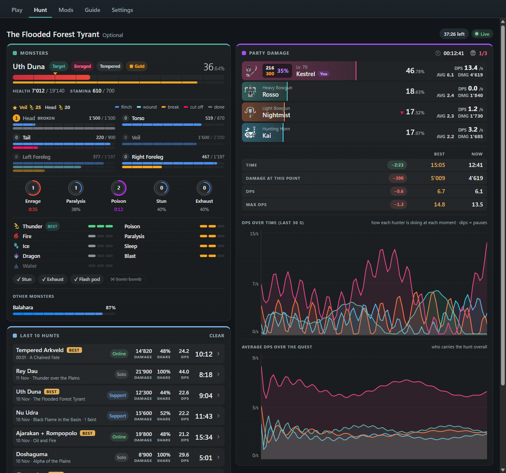
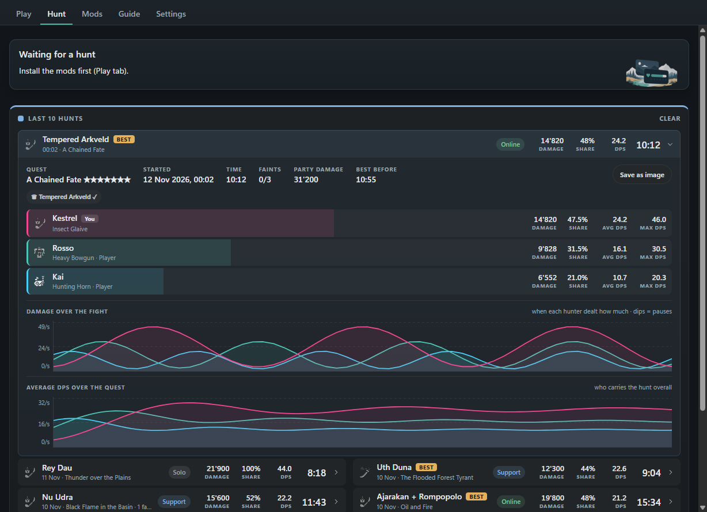
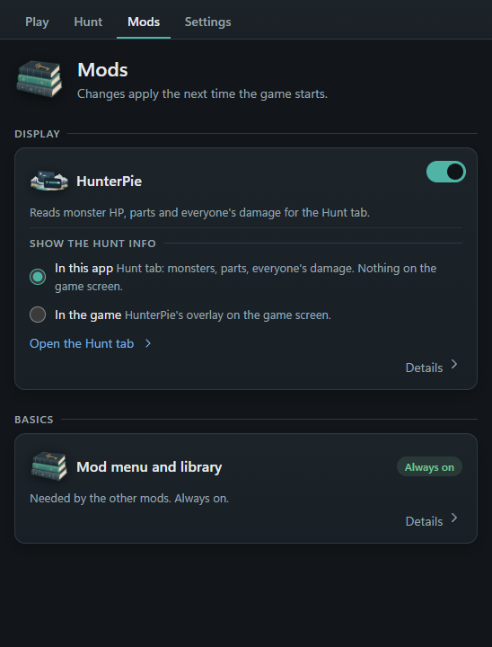
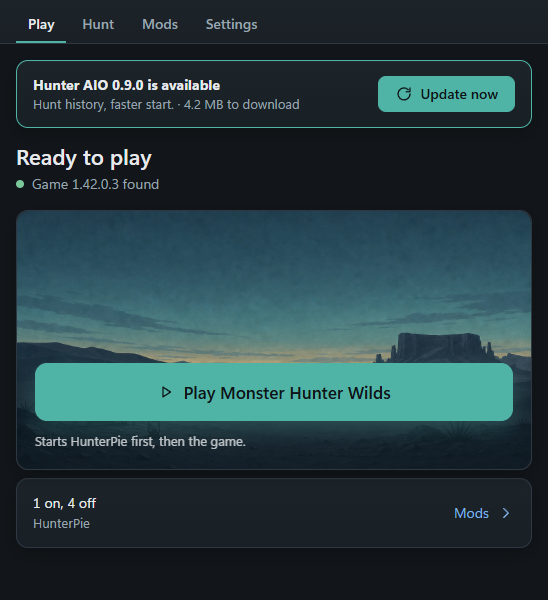
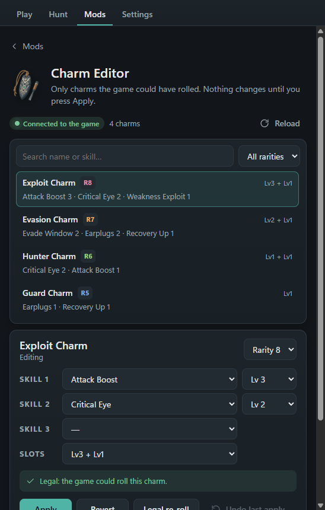
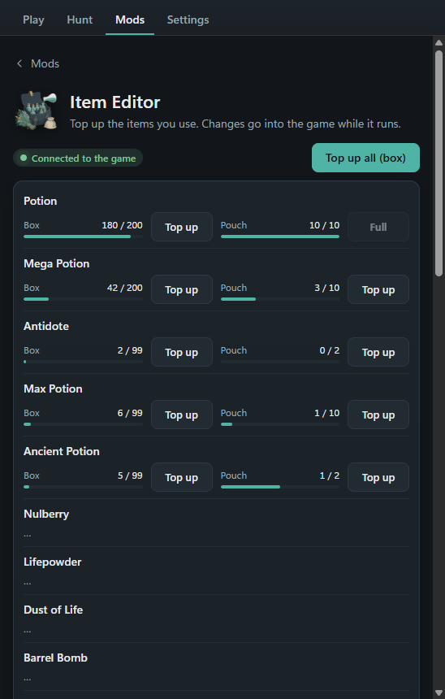
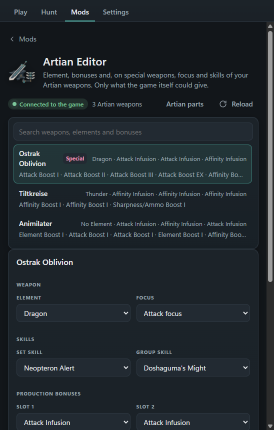
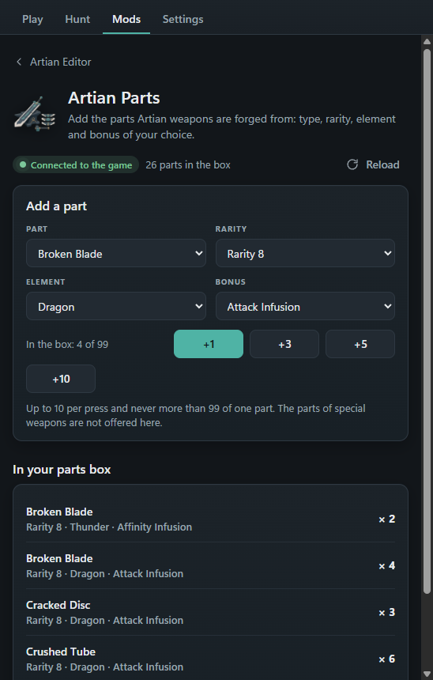
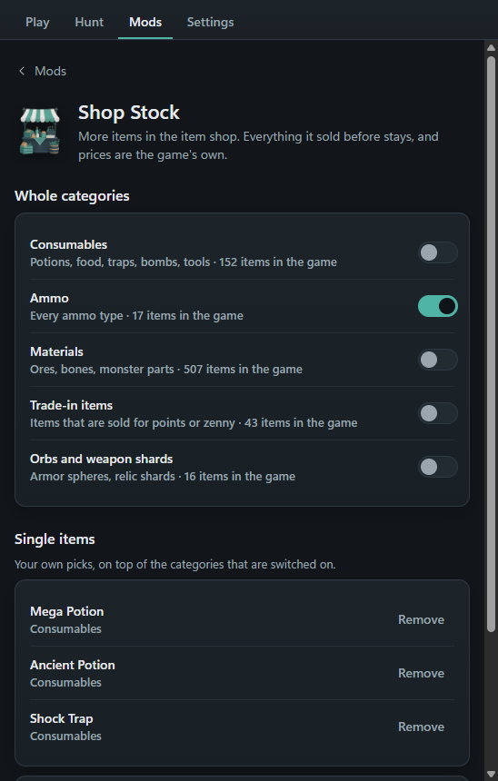
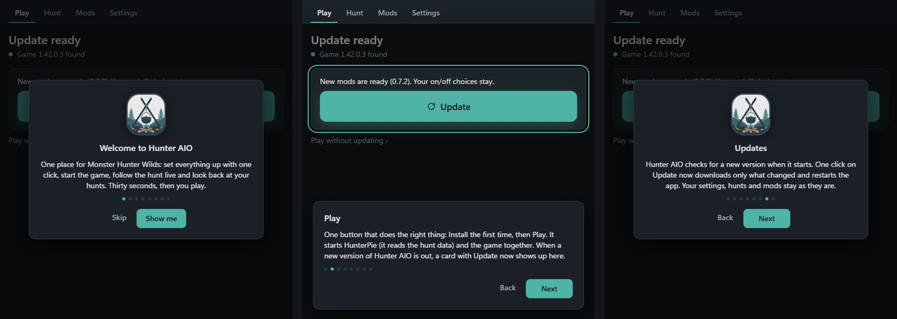

# Hunter AIO

A small Windows app for **Monster Hunter Wilds** (Steam). One click sets up the mod loader and the hunt-data reader, one button starts everything with the game, and the hunt shows in its own window instead of on top of the game. Editors for charms, items and Artian weapons are included and switched off until you want them.

**[Download the latest version](https://github.com/MkUltra1984/hunter-aio/releases/latest)** · free · Windows 10/11 · [Deutsch](#deutsch)

## Showcase

### Follow the hunt live

Monster health, parts and status build-up on the left; everyone's damage, share and DPS on the right, with charts of the fight. It runs in its own window, so it fits a second screen and nothing covers the game.

### Race your personal best

During a quest the app shows your best run of that quest next to the current one: best time, the damage you had at this exact minute back then, DPS and max DPS, and whether you are ahead or behind. Bests are kept per quest, because the same monster has different health in different quests.

### Look back at your hunts

Your last 10 successful hunts with time, damage, share and whether you went solo, with support hunters or online. Click one to open it: every party member's numbers and a chart of who dealt how much damage when.

### One button to play

| Set up and play | Mods | Updates itself |
|---|---|---|
|  |  |  |
| **Install now** finds the game and sets everything up. After that, **Play** starts HunterPie and the game together. | Each mod has a switch. Choose whether the hunt info shows in the app or as HunterPie's overlay in the game. | The app checks this page when it starts. **Update now** downloads only what changed and restarts. |

### Editors (optional, off by default)

They are controlled from the app while the game runs; there is no menu in the game. They change your save, so each one asks before it is switched on, and the app backs up your save before every game start while one is on.

| Charm Editor | Item Editor |
|---|---|
|  |  |
| Set the skills and slots of your rolled charms. The dropdowns only offer combinations the game itself can roll. Presets, copy from another charm, re-roll, share codes and undo. | A quick list of the items you use, with **Top up** per item or for the whole list, in box or pouch. Search any other item. Zenny, points and vouchers in capped steps. |

| Artian Editor | Artian Parts | Shop Stock |
|---|---|---|
|  |  |  |
| Element, production and reinforcement bonuses of your Artian weapons; on special weapons also focus and skills. Lists and limits come from the game. | Add the parts Artian weapons are forged from: type, rarity, element and bonus. | More items in the item shop: whole categories or single items you pick. Works in memory only; switch it off and the shop is the original again. |

The editors change weapons and charms you already own. They do not create weapons or charms.

### A tour on first start

A short tour explains every tab, and you can replay it under Settings → About.

## Features

- **One-click setup and removal** of [REFramework](https://github.com/praydog/REFramework) and a build of [HunterPie](https://github.com/HunterPie/HunterPie).
- **Hunt tab**: target monster with health, stamina, capture line, weaknesses, parts and ailments; other monsters; damage meter with DPS, average and charts.
- **Personal bests per quest** with a live comparison during the hunt.
- **Hunt history**: the last 10 successful hunts, each with full party stats and a damage-over-the-fight chart.
- **Charm, Item and Artian editors, Artian parts, Shop Stock**: optional, off by default.
- **Save backups** with restore, and a backup before anything is installed.
- **In-app updates** and a desktop shortcut.

## Install

1. Download `HunterAIO-<version>.zip` from the [latest release](https://github.com/MkUltra1984/hunter-aio/releases/latest). The smaller zips there are for the in-app updater; you don't need them.
2. Unzip it anywhere and start `HunterAIO.exe`.
3. Press **Install now**, then **Play Monster Hunter Wilds**.

After the first start the folder shows only `HunterAIO.exe`. The other files are still there, just hidden, so the folder stays tidy. Keep the folder together when you move it.

HunterPie needs the [.NET Desktop Runtime 10.0 (x64)](https://dotnet.microsoft.com/download/dotnet/10.0).

### Windows warning on first start

The exe is not signed, so Windows SmartScreen may show "Windows protected your PC" the first time. Choose *More info* → *Run anyway*. Signing costs money every year, which is why a free hobby tool comes without it. If your antivirus complains, check the file on [VirusTotal](https://www.virustotal.com/) and report a false alarm to the vendor.

## Questions

**Is this safe for my account?** With the editors off, the app only reads the game's memory through HunterPie to show hunt data. The editors change your own save, and Shop Stock changes what your item shop sells; nothing here touches other players. Mods are never officially supported, so you use them at your own risk. Follow Capcom's rules, and think twice before taking edited gear into multiplayer.

**Can the editors break my save?** They only write values the game's own tables allow, and the app keeps the last 10 backups of your save. The editors are new: use them on a backed-up save first and report anything odd.

**Where is my data?** Everything stays on your PC in `%LOCALAPPDATA%\HunterAIO` (settings, hunt history, save backups). The app only contacts GitHub, to look for updates.

**How do I remove it?** Settings → Advanced → *Uninstall everything*, then delete the folder.

**Which language?** The interface is English only for now.

**Something is broken.** Open an [issue](https://github.com/MkUltra1984/hunter-aio/issues) and say what you did and what happened. Please don't report problems with the included HunterPie build to the HunterPie project.

## Credits and licences

- **REFramework** by praydog, MIT licence, included unmodified.
- **HunterPie** by Haato and contributors, Apache License 2.0. The included build is **modified**: one extra read-only service writes the hunt data to a local file for this app. It is not an official HunterPie release. The Hunt tab follows HunterPie's widget design and uses its icons.
- The editors and Shop Stock are written for Hunter AIO. Thanks to **lingsamuel**, whose Charm, Item and Artian editors showed how the game stores these things.
- Details and licence texts: [licenses/](licenses/).

Hunter AIO itself is by MkUltra1984 and free to use. Not affiliated with Capcom. Monster Hunter Wilds is a Capcom game.

---

## Deutsch

Eine kleine Windows-App für **Monster Hunter Wilds** (Steam). Ein Klick richtet den Mod-Loader und das Auslesen der Jagddaten ein, ein Knopf startet alles zusammen mit dem Spiel, und die Jagd erscheint in einem eigenen Fenster statt über dem Spiel. Editoren für Talismane, Items und Artian-Waffen sind dabei und ausgeschaltet, bis du sie willst.

**[Neueste Version herunterladen](https://github.com/MkUltra1984/hunter-aio/releases/latest)** · kostenlos · Windows 10/11

### Was die App zeigt

- **Die Jagd live**: links Lebenspunkte, Körperteile und Statusaufbau des Monsters, rechts Schaden, Anteil und DPS aller Jäger mit Diagrammen. Eigenes Fenster, ideal für einen zweiten Bildschirm; nichts verdeckt das Spiel.
- **Gegen die eigene Bestzeit**: Während einer Quest siehst du deinen besten Lauf dieser Quest neben dem aktuellen: Bestzeit, dein Schaden zur selben Minute, DPS und Max-DPS, dazu ob du vorne oder hinten liegst. Bestzeiten gelten pro Quest, weil dasselbe Monster je nach Quest unterschiedlich viele Lebenspunkte hat.
- **Jagdverlauf**: die letzten 10 erfolgreichen Jagden mit Zeit, Schaden, Anteil und ob solo, mit Hilfsjägern oder online. Ein Klick öffnet die Jagd mit den Werten aller Jäger und einem Diagramm, wer wann wie viel Schaden gemacht hat.
- **Ein Knopf zum Spielen**: „Install now“ findet das Spiel und richtet alles ein, danach startet „Play“ HunterPie und das Spiel gemeinsam.
- **Aktualisiert sich selbst**: Die App schaut beim Start hier nach; „Update now“ lädt nur, was sich geändert hat.
- **Sicherung der Spielstände** mit Wiederherstellung, Desktop-Verknüpfung, kurze Tour beim ersten Start.

### Editoren (optional, standardmäßig aus)

Sie werden aus der App bedient, während das Spiel läuft; im Spiel gibt es kein Menü. Sie verändern deinen Spielstand: Jeder fragt vor dem Einschalten nach, und solange einer an ist, sichert die App deinen Spielstand vor jedem Spielstart.

- **Charm Editor**: Fähigkeiten und Slots deiner gewürfelten Talismane. Zur Auswahl steht nur, was das Spiel selbst würfeln kann. Vorlagen, Kopieren, Neu würfeln, Codes zum Teilen, Rückgängig.
- **Item Editor**: eine Schnellliste deiner Items mit „Top up“ pro Item oder für die ganze Liste, in Kiste oder Beutel. Jedes andere Item per Suche. Zenny, Punkte und Gutscheine in begrenzten Schritten.
- **Artian Editor**: Element, Herstellungs- und Verstärkungsboni deiner Artian-Waffen; bei besonderen Waffen auch Fokus und Fähigkeiten. Listen und Grenzen stammen aus dem Spiel.
- **Artian Parts**: fügt Artian-Teile hinzu (Art, Seltenheit, Element, Bonus).
- **Shop Stock**: mehr Items im Item-Laden, ganze Kategorien oder einzelne Items. Nur im Arbeitsspeicher; ausgeschaltet ist der Laden wieder der ursprüngliche.

Die Editoren ändern Waffen und Talismane, die du schon besitzt. Sie erzeugen keine neuen.

### Installation

1. `HunterAIO-<Version>.zip` aus dem [neuesten Release](https://github.com/MkUltra1984/hunter-aio/releases/latest) laden. Die kleineren Zips dort sind für die Update-Funktion; die brauchst du nicht.
2. Irgendwo entpacken und `HunterAIO.exe` starten.
3. **Install now** drücken, danach **Play Monster Hunter Wilds**.

Nach dem ersten Start zeigt der Ordner nur noch `HunterAIO.exe`. Die übrigen Dateien sind weiterhin da, nur ausgeblendet. Verschiebe den Ordner immer als Ganzes.

HunterPie braucht die [.NET Desktop Runtime 10.0 (x64)](https://dotnet.microsoft.com/download/dotnet/10.0).

**Windows-Warnung beim ersten Start:** Die exe ist nicht signiert, deshalb zeigt Windows SmartScreen eventuell „Der Computer wurde durch Windows geschützt“. *Weitere Informationen* → *Trotzdem ausführen*. Eine Signatur kostet jedes Jahr Geld; darum kommt ein kostenloses Hobby-Werkzeug ohne sie aus.

### Fragen

- **Ist das sicher für meinen Account?** Mit ausgeschalteten Editoren liest die App nur über HunterPie den Speicher des Spiels aus, um die Jagddaten zu zeigen. Die Editoren ändern deinen eigenen Spielstand, Shop Stock das Angebot deines Item-Ladens; andere Spieler betrifft nichts davon. Mods werden nie offiziell unterstützt; du nutzt sie auf eigenes Risiko. Halte dich an die Regeln von Capcom und überlege es dir gut, bevor du bearbeitete Ausrüstung in den Mehrspielermodus mitnimmst.
- **Können die Editoren meinen Spielstand beschädigen?** Sie schreiben nur Werte, die die Tabellen des Spiels erlauben, und die App behält die letzten 10 Sicherungen. Die Editoren sind neu: Probiere sie zuerst mit einem gesicherten Spielstand aus und melde, was dir merkwürdig vorkommt.
- **Wo liegen meine Daten?** Alles bleibt auf deinem PC unter `%LOCALAPPDATA%\HunterAIO`. Die App kontaktiert nur GitHub, um nach Updates zu schauen.
- **Wie entferne ich sie?** Settings → Advanced → *Uninstall everything*, danach den Ordner löschen.
- **Sprache?** Die Oberfläche ist zurzeit nur auf Englisch.

### Credits und Lizenzen

- **REFramework** von praydog, MIT-Lizenz, unverändert enthalten.
- **HunterPie** von Haato und Mitwirkenden, Apache License 2.0. Der enthaltene Build ist **angepasst**: Ein zusätzlicher, nur lesender Dienst schreibt die Jagddaten für diese App in eine lokale Datei. Es ist kein offizielles HunterPie-Release; bitte melde Probleme damit nicht beim HunterPie-Projekt.
- Die Editoren und Shop Stock sind für Hunter AIO geschrieben. Dank an **lingsamuel**, dessen Charm-, Item- und Artian-Editoren gezeigt haben, wie das Spiel diese Dinge speichert.
- Details und Lizenztexte: [licenses/](licenses/).

Hunter AIO selbst ist von MkUltra1984 und kostenlos nutzbar. Keine Verbindung zu Capcom. Monster Hunter Wilds ist ein Spiel von Capcom.
