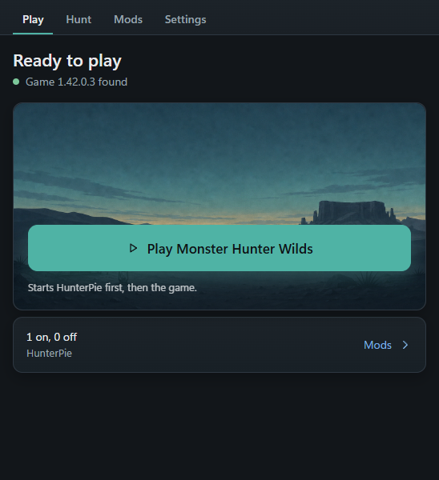

# Hunter AIO

A small Windows app for **Monster Hunter Wilds** (Steam). It installs the mod loader and a hunt-data reader with one click, starts them together with the game, and shows the hunt in its own window instead of drawing over the game.

[Deutsch weiter unten](#deutsch)

## What it does

- **One-click setup**: finds the game, installs [REFramework](https://github.com/praydog/REFramework) and a build of [HunterPie](https://github.com/HunterPie/HunterPie), and removes everything again on request. Your saves are not touched.
- **Hunt tab**: monster health, parts and status build-up, everyone's damage with DPS and charts, in a separate window (good for a second screen).
- **Hunt history**: your last 10 successful hunts with full stats, and a personal best per monster that the running hunt is compared against.
- **Save backups** before anything is installed, with restore.
- **Updates itself**: the app checks this page when it starts and offers "Update now".

## Download

1. Get `HunterAIO-<version>.zip` from the [latest release](https://github.com/MkUltra1984/hunter-aio/releases/latest) (not the smaller zips; those are for the updater).
2. Unzip it anywhere and start `HunterAIO.exe`. Windows SmartScreen may warn once because the exe is not signed: *More info* → *Run anyway*.
3. Press **Install now**, then **Play Monster Hunter Wilds**.

HunterPie needs the [.NET Desktop Runtime 10.0 (x64)](https://dotnet.microsoft.com/download/dotnet/10.0).

## Good to know

- Windows 10/11, Steam version of the game.
- The app reads the game's memory through HunterPie to show hunt data. It changes nothing for other players. Use mods at your own risk and follow Capcom's rules.
- The interface is English only for now.

## Credits and licences

- **REFramework** by praydog, MIT licence, included unmodified.
- **HunterPie** by Haato and contributors, Apache License 2.0. The included build is **modified**: it has one extra read-only service that writes the hunt data to a local file for this app. It is not an official HunterPie release; please don't report problems with it to the HunterPie project.
- Details and licence texts: [licenses/](licenses/).

Hunter AIO itself is by MkUltra1984 and free to use. Not affiliated with Capcom. Monster Hunter Wilds is a Capcom game.

---

## Deutsch

Eine kleine Windows-App für **Monster Hunter Wilds** (Steam). Sie installiert den Mod-Loader und ein Programm zum Auslesen der Jagddaten mit einem Klick, startet beides zusammen mit dem Spiel und zeigt die Jagd in einem eigenen Fenster, statt etwas über das Spiel zu legen.

### Was sie kann

- **Einrichtung mit einem Klick**: findet das Spiel, installiert [REFramework](https://github.com/praydog/REFramework) und einen Build von [HunterPie](https://github.com/HunterPie/HunterPie) und entfernt auf Wunsch alles wieder. Deine Spielstände bleiben unberührt.
- **Reiter „Hunt“**: Lebenspunkte, Körperteile und Statusaufbau der Monster, der Schaden aller Jäger mit DPS und Diagrammen, in einem eigenen Fenster (praktisch für einen zweiten Bildschirm).
- **Jagdverlauf**: deine letzten 10 erfolgreichen Jagden mit allen Werten und eine persönliche Bestzeit pro Monster, mit der die laufende Jagd verglichen wird.
- **Sicherung der Spielstände** vor jeder Installation, mit Wiederherstellung.
- **Aktualisiert sich selbst**: Die App schaut beim Start auf dieser Seite nach und bietet „Update now“ an.

### Download

1. `HunterAIO-<Version>.zip` aus dem [neuesten Release](https://github.com/MkUltra1984/hunter-aio/releases/latest) laden (nicht die kleineren Zips, die sind für die Update-Funktion).
2. Irgendwo entpacken und `HunterAIO.exe` starten. Windows SmartScreen warnt eventuell einmal, weil die exe nicht signiert ist: *Weitere Informationen* → *Trotzdem ausführen*.
3. **Install now** drücken, danach **Play Monster Hunter Wilds**.

HunterPie braucht die [.NET Desktop Runtime 10.0 (x64)](https://dotnet.microsoft.com/download/dotnet/10.0).

### Gut zu wissen

- Windows 10/11, Steam-Version des Spiels.
- Die App liest über HunterPie den Speicher des Spiels aus, um die Jagddaten zu zeigen. Für andere Spieler ändert sie nichts. Mods nutzt du auf eigenes Risiko; halte dich an die Regeln von Capcom.
- Die Oberfläche ist zurzeit nur auf Englisch.

### Credits und Lizenzen

- **REFramework** von praydog, MIT-Lizenz, unverändert enthalten.
- **HunterPie** von Haato und Mitwirkenden, Apache License 2.0. Der enthaltene Build ist **angepasst**: Er hat einen zusätzlichen, nur lesenden Dienst, der die Jagddaten für diese App in eine lokale Datei schreibt. Es ist kein offizielles HunterPie-Release; bitte melde Probleme damit nicht beim HunterPie-Projekt.
- Details und Lizenztexte: [licenses/](licenses/).

Hunter AIO selbst ist von MkUltra1984 und kostenlos nutzbar. Keine Verbindung zu Capcom. Monster Hunter Wilds ist ein Spiel von Capcom.
